  

<h1 align="center">👋 Olá! Bem-vindo ao meu GitHub.</h1>

  Estudante de tecnologia e desenvolvimento de software, compartilhando projetos acadêmicos, experimentos e soluções em programação, dados, inteligência artificial e automação.

  <a href="https://www.linkedin.com/in/bpoltosi/">LinkedIn</a> ·
  <a href="https://github.com/bpoltosi">GitHub</a>

## Sobre meus estudos

- Desenvolvimento de software, algoritmos e engenharia de sistemas
- Inteligência artificial, agentes e automação de workflows
- Dados, SQL e bancos de dados
- Desenvolvimento web e aplicações
- Swift, C, Java, Python e JavaScript/TypeScript

## Projetos em destaque

| Projeto | Repositório | Andamento / foco atual |
|---|---|---|
| **AI Software Factory** | [ia-factory](https://github.com/bpoltosi/ia-factory) | Arquitetura multiagente em evolução. Fase 1 concluída; trabalho recente na fronteira de execução local (LocalRDC), integração do Control Plane e revisão de arquitetura. |
| **BinGoat** | [BinGoat](https://github.com/bpoltosi/BinGoat) | Bingo com motor e backend HTTP nativos em C, frontend web Vite e CLI. Avanço recente em testes end-to-end e validação da API. |
| **SportsCam** | [SportsCam](https://github.com/bpoltosi/SportsCam) | Plataforma modular de captura esportiva e replay: engine TypeScript, API, runtime Python para dispositivos/câmeras e processamento de clips. |
| **UFSM-MDT** | [ufsm-mdt](https://github.com/bpoltosi/ufsm-mdt) | Ferramenta de documentos acadêmicos: núcleo Python de validação/geração LaTeX e interface web. Melhorias recentes de UX, persistência, validação, exportação e auditoria. |
| **Hub Acadêmico** | [HubAcademico](https://github.com/bpoltosi/HubAcademico) | Aplicativo iOS em SwiftUI para compartilhar e consultar projetos, trabalhos, provas e materiais. Integração/backend via Node-RED e Cloudant documentada. |
| **Sistema de Reservas Esportivas** | [SistemaReservas](https://github.com/bpoltosi/SistemaReservas) | Estrutura modular para reservas de quadras e complexos, com web/API, modalidades, pagamentos, notificações e integração de fontes open source via submodules. |
| **OpenBrew** | [OpenBrew](https://github.com/bpoltosi/OpenBrew) | Protótipos Arduino para monitorar preparo de café: leitura de peso e evolução para comunicação I2C com periféricos. |
| **Estacionamento** | [ProjetosJavaScript](https://github.com/bpoltosi/ProjetosJavaScript/tree/main/SistemaControleEstacionamento) | Aplicação de controle com regras, painel web, configuração de setores e vagas. Recentes ajustes no layout adaptativo das molduras e organização compacta dos setores. |
| **Projetos Swift / HackaTruck** | [Swift](https://github.com/bpoltosi/Swift) | Exercícios e aplicações Swift/SwiftUI, com navegação, listas, interfaces e desafios práticos do HackaTruck. |
| **Projetos C** | [ProjetosC](https://github.com/bpoltosi/ProjetosC) | Exercícios de fundamentos, matrizes, strings, funções, ponteiros, structs e arquivos; inclui o Bingo acadêmico original. |
| **Projetos de Banco de Dados** | [ProjetosBancoDeDados](https://github.com/bpoltosi/ProjetosBancoDeDados) | Modelagem e scripts SQL/Oracle, projeto de gestão da construção civil e materiais SQL/T-SQL/NoSQL. |

## Projetos em andamento / próximos passos

| Projeto | Repositório / diretório | Próximo foco |
|---|---|---|
| **Controle de Estacionamento** | [SistemaControleEstacionamento](https://github.com/bpoltosi/ProjetosJavaScript/tree/main/SistemaControleEstacionamento) | Continuar refinando o painel de configuração, categorias e comportamento visual/geométrico dos setores; validar fluxo de criação e configuração. |
| **Aplicativo de Gestão de Trens** | [ArquivosAplicativoTrem](https://github.com/bpoltosi/ProjetosJavaScript/tree/main/ArquivosAplicativoTrem) | Evoluir a modelagem e as funcionalidades do exercício/projeto ferroviário. |
| **Sistema de Reservas** | [SistemaReservas](https://github.com/bpoltosi/SistemaReservas) | Conectar e validar componentes importados, consolidando os contratos de API e a autoridade central de reservas. |
| **SportsCam** | [SportsCam](https://github.com/bpoltosi/SportsCam) | Continuar a integração entre catálogo, engine, backend, runtime de dispositivos e fluxo de captura/replay. |
| **AI Software Factory** | [ia-factory](https://github.com/bpoltosi/ia-factory) | Seguir a evolução do orquestrador, agentes e execução local com limites claros de autoridade e integração. |
| **OpenBrew** | [OpenBrew](https://github.com/bpoltosi/OpenBrew) | Retomar os protótipos e validar os ajustes pendentes de leitura e exibição de dados do circuito. |

> Os status são um resumo de desenvolvimento e documentação — não significam que todas as funcionalidades estejam testadas, finalizadas ou em produção. Projetos acadêmicos, protótipos e iniciativas experimentais estão identificados pelo contexto.

## Linguagens e ferramentas

  
  
  
  
  
  
  
  

## Atividade no GitHub

  
  

  

