  

<h1 align="center">👋 Olá! Bem-vindo ao meu GitHub.</h1>

  Estudante de tecnologia e desenvolvimento de software, compartilhando projetos acadêmicos, experimentos e estudos em programação, dados e inteligência artificial.

  <a href="https://www.linkedin.com/in/bpoltosi/">LinkedIn</a> ·
  <a href="https://github.com/bpoltosi">GitHub</a>

## Áreas de estudo

- Desenvolvimento de software e programação
- Inteligência artificial e sistemas multiagentes
- Dados, SQL e bancos de dados
- Desenvolvimento web e aplicações
- Swift, C, Java, Python e JavaScript

## Projetos em destaque

| Repositório | Tema |
|---|---|
| [ProjetosC](https://github.com/bpoltosi/ProjetosC) | Exercícios em C e projeto de Bingo |
| [ProjetosSwift](https://github.com/bpoltosi/ProjetosSwift) | Swift, SwiftUI e desafios HackaTruck |
| [SportsCam](https://github.com/bpoltosi/SportsCam) | Plataforma modular de captura e replay esportivo |
| [ufsm-mdt](https://github.com/bpoltosi/ufsm-mdt) | Ferramenta para documentos acadêmicos conforme a MDT/UFSM |
| [SistemaReservas](https://github.com/bpoltosi/SistemaReservas) | Estudo de integração de sistemas de reservas esportivas |
| [ia-factory](https://github.com/bpoltosi/ia-factory) | Arquitetura de uma fábrica de desenvolvimento com agentes |
| [ProjetosBancoDeDados](https://github.com/bpoltosi/ProjetosBancoDeDados) | Modelagem e scripts SQL |

## Projetos em desenvolvimento

> 🚧 **Status: em desenvolvimento (WIP) · projetos em aberto.** Estes projetos estão sendo avaliados, reorganizados e ampliados a partir de trabalhos acadêmicos e repositórios de estudo. A implementação, as funcionalidades e a documentação ainda podem mudar.

| Projeto | Repositório de origem | Status |
|---|---|---|
| Bingo em C | [ProjetosC / TrabalhoBingo](https://github.com/bpoltosi/ProjetosC/tree/main/TrabalhoBingo) | 🚧 Em desenvolvimento · Aberto |
| Sistema de Controle de Estacionamento | [ProjetosJavaScript / SistemaControleEstacionamento](https://github.com/bpoltosi/ProjetosJavaScript/tree/main/SistemaControleEstacionamento) | 🚧 Em desenvolvimento · Aberto |
| Aplicativo de Gestão de Trens | [ProjetosJavaScript / ArquivosAplicativoTrem](https://github.com/bpoltosi/ProjetosJavaScript/tree/main/ArquivosAplicativoTrem) | 🚧 Em desenvolvimento · Aberto |
| Catálogo de Jogos de Tabuleiro | [ProjetosSwift / Desafio05](https://github.com/bpoltosi/ProjetosSwift/tree/main/hackatruck/presencial/semana02/Desafio05) | 🚧 Em desenvolvimento · Aberto |
| Cardápio Digital | [ProjetosSwift / Desafio08](https://github.com/bpoltosi/ProjetosSwift/tree/main/hackatruck/presencial/semana02/Desafio08) | 🚧 Em desenvolvimento · Aberto |
| Classificador de Imagens com Core ML | [ProjetosSwift / Desafio09](https://github.com/bpoltosi/ProjetosSwift/tree/main/hackatruck/presencial/semana02/Desafio09) | 🚧 Em desenvolvimento · Aberto |
| StudyCast — leitura e análise de textos | [ProjetosSwift / Desafio10](https://github.com/bpoltosi/ProjetosSwift/tree/main/hackatruck/presencial/semana02/Desafio10) | 🚧 Em desenvolvimento · Aberto |
| Gestão de Obras com Oracle SQL | [ProjetosBancoDeDados / Sistema-Gestao-Construcao-Civil-Oracle](https://github.com/bpoltosi/ProjetosBancoDeDados/tree/main/Sistema-Gestao-Construcao-Civil-Oracle) | 🚧 Em desenvolvimento · Aberto |
| OpenBrew — monitoramento de preparo de café | [OpenBrew](https://github.com/bpoltosi/OpenBrew) | 🚧 Em desenvolvimento · Aberto |

Os links apontam para os diretórios originais dentro dos repositórios de estudo. Os projetos ainda não possuem, necessariamente, repositórios independentes; a separação e a evolução serão feitas gradualmente.

## Linguagens e ferramentas

  
  
  
  
  
  
  
  

## Atividade no GitHub

  
  

  

